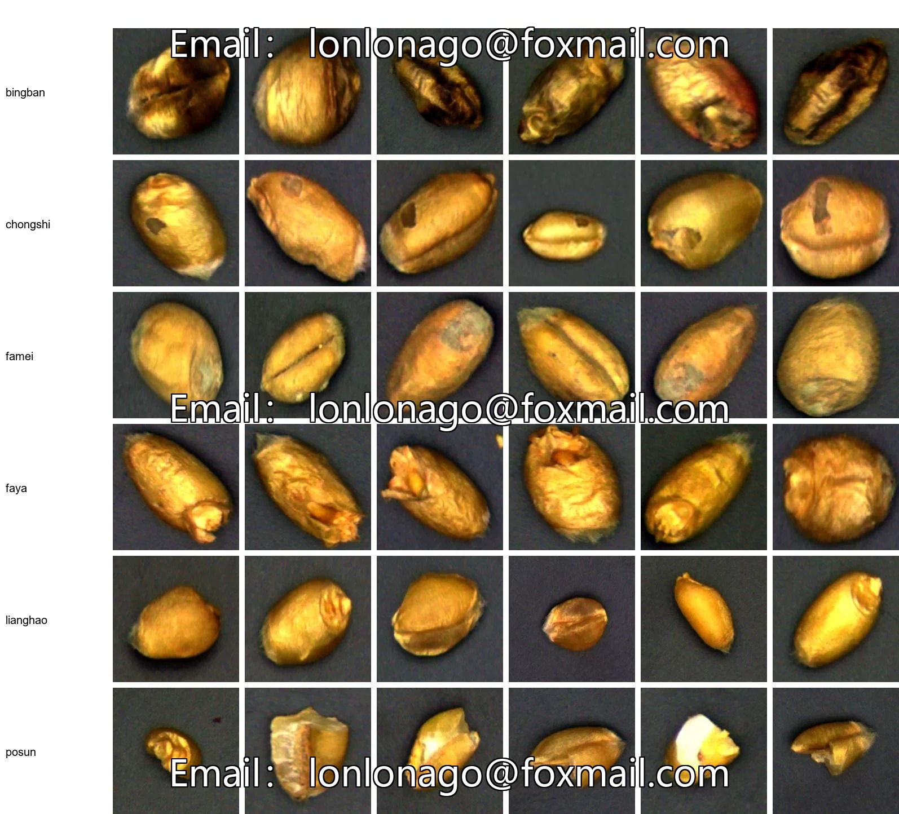
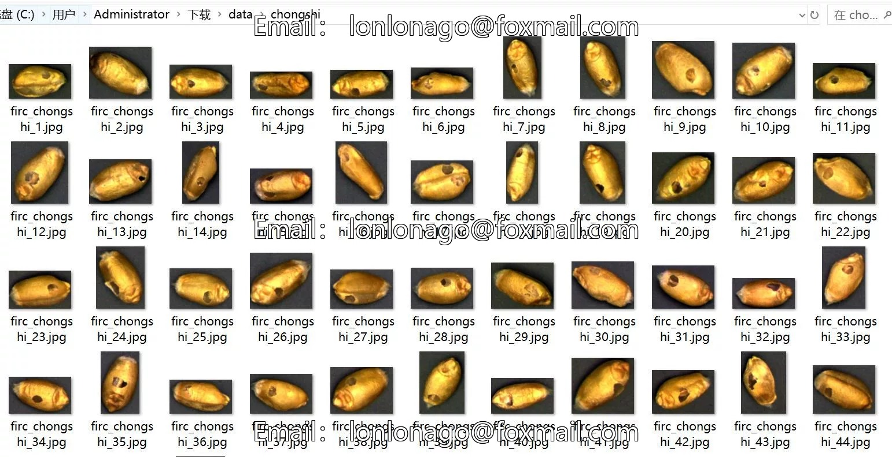
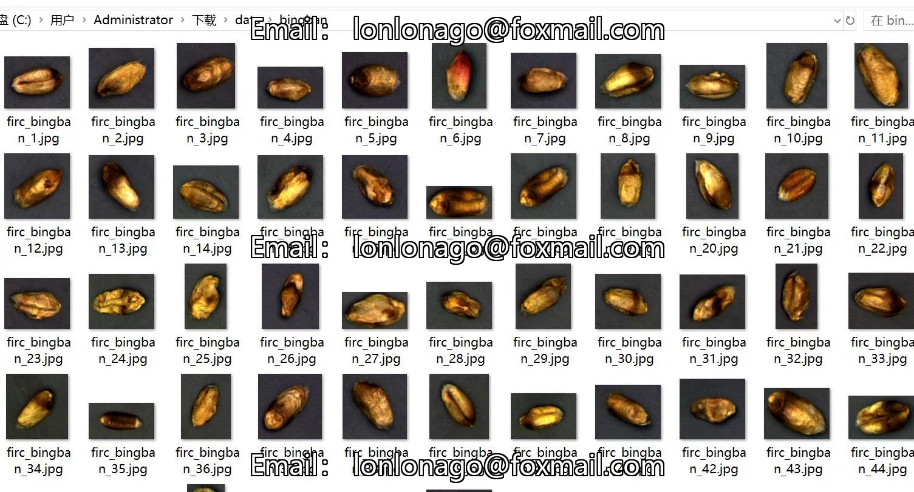
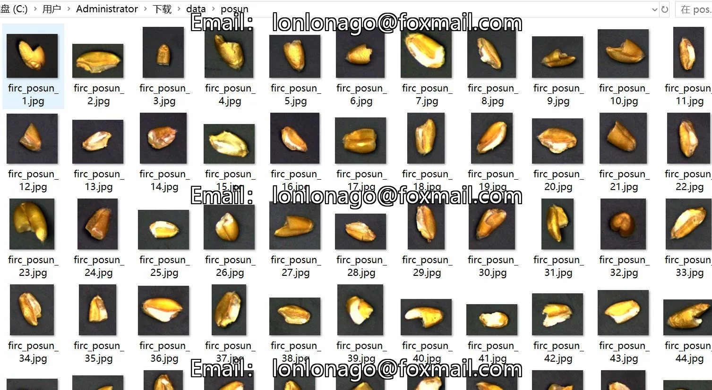

# Wheat Seed Grain Quality Assessment Quality Image Classification Dataset: 2406 images in 6 categories

## Body

Wheat Seed Grain Quality Assessment Quality Image Classification Dataset - 2406 Images in 6 Categories
Warm Reminder: Due to the dataset's replicability, please confirm compliance with requirements before purchasing.
Dataset Type: For image classification purposes, not for target detection with unlabeled files.
Dataset Format: Only contains jpg images, each category folder contains corresponding images.
Number of Images (Total JPG Files): 2604
Number of Categories: 6
Category Names: ["bingban", "chongshi", "famei", "faya", "lianghao", "posun"]
Image Count per Category
Bing Ban (Diseased Spots) 485 Images

chongshi (worm damage) 481 images
famei (mold growth) 371 images
faya (sprout) 367 images
lianghao (good condition) 480 images
posun (damage) 420 images
Important Note: The dataset does not include splitting into training, validation, and test sets; you must do this yourself.
Special Remark: This dataset does not guarantee the accuracy of the trained models or weight files; it only provides accurate data.

## Images

## Payment

Here is a pay link on Stripe ( https://buy.stripe.com/3cs8yP7sY87d0vu9AB ). Please contact me lonlonago@foxmail.com after funding $89, and I will send you a complete data files , thank you!

